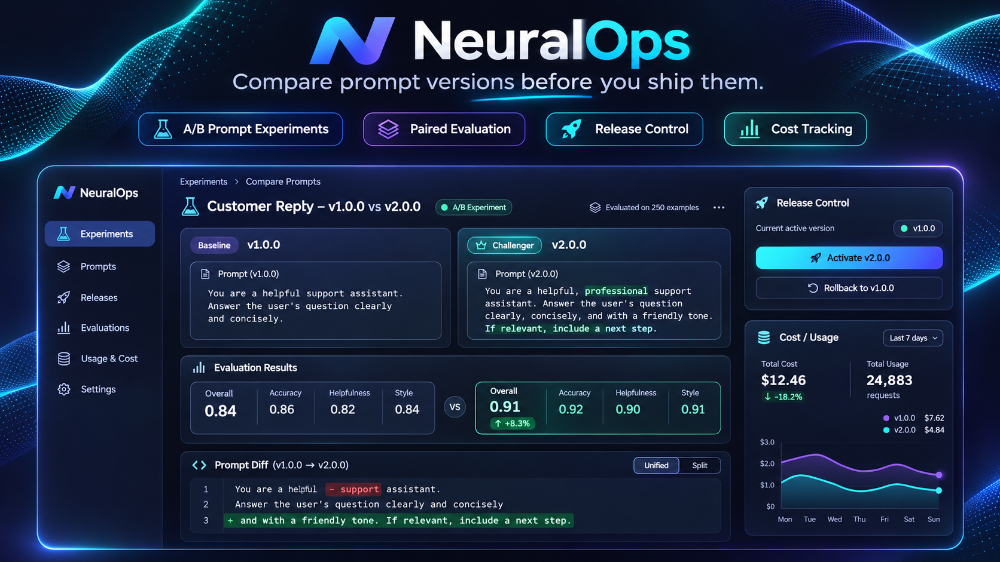

# NeuralOps

**Compare prompt versions before you ship them.** NeuralOps runs the same inputs through a baseline and a challenger, shows their answers and paired evaluation results, and lets you activate or roll back a release explicitly.

[](https://github.com/0DevDutt0/NeuralOps/actions/workflows/ci.yml)
[](LICENSE)

[Run the demo](#run-the-demo) · [Benchmark results](Demo/README.md) · [Run with a live provider](#run-with-a-live-provider)

[](#run-the-demo)

*The mockup uses illustrative data. See the [18-case benchmark](Demo/README.md) for the reproducible results.*

## Run the demo

The seeded demo starts with two customer-support prompt versions and a completed 18-case experiment. It uses an in-memory SQLite database and deterministic local responses. It needs no API keys and does not write to an existing NeuralOps database.

With Python 3.11 or 3.12, create and activate a virtual environment, then install the package from the repository root.

```sh
python -m venv .venv
# macOS or Linux
source .venv/bin/activate
# Windows PowerShell: .venv\Scripts\Activate.ps1
python -m pip install -e .
python -m neuralops.demo
```

In a second terminal with the same environment, start the dashboard.

```sh
python -m streamlit run dashboard/app.py
```

1. Open [the dashboard](http://localhost:8501) and select **Experiments**. Open the support-policy benchmark, inspect a trial, and compare the answers.
2. In **Prompt Manager**, compare versions `1.0.0` and `2.0.0` with **Compute Diff**. The baseline starts active. Choose `2.0.0` and select **Activate**, then choose `1.0.0` and select **Rollback**.
3. Open **Cost Tracker** to see generation and judge usage by stage. The local demo records estimated tokens and has zero provider spend.

Reproduce the benchmark report without starting a server.

```sh
python -m neuralops.demo --benchmark
```

The API docs are at [localhost:8000/docs](http://localhost:8000/docs) while the demo server is running. See the [benchmark, limitations, and recording notes](Demo/README.md).

## How experiments work

- **Versioning.** Store prompt templates with SemVer tags, inspect unified diffs, and update the active version through explicit release actions.
- **Evaluation.** The generation calls run concurrently for each input, followed by two concurrent judge calls. The judge returns individual criteria and NeuralOps computes the weighted score. Failed judge pairs are flagged, displayed, and excluded from the valid-pair count.
- **Release decision.** An experiment starts with a configured number of valid pairs. At that endpoint, NeuralOps reports the mean B−A difference, a paired t-test and a confidence interval when estimable. A recommendation leaves the active version in place. Use independently selected cases and keep the evaluation set fixed before collecting results.
- **Usage.** Successful generation and judge responses contribute token counts and estimated USD cost. The API and dashboard aggregate those records by stage, provider, and model. Costs use local rate estimates and actual provider bills may differ. Older trials can lack usage records.
- **Monitoring.** An hourly scheduled check scores synthetic outputs for active prompt versions. Telegram notifications are optional. Presidio, toxicity scoring and off-topic checks are available as separate guardrail components.

The API is built with FastAPI, async SQLAlchemy and Alembic. The Streamlit dashboard calls the same API routes. SQLite supports local development and PostgreSQL backs the Compose stack.

| Start here | Code |
| --- | --- |
| Paired trials and scoring | [Runner](neuralops/engine/ab_runner.py), [judge](neuralops/engine/judge.py) |
| Prompt diff, activation and rollback | [Prompt service](neuralops/services/prompt_service.py) |
| Fixed-set offline benchmark | [Demo implementation](neuralops/demo.py), [results](Demo/README.md) |
| Usage and experiment API | [Router](neuralops/api/routers/experiments.py), [service](neuralops/services/experiment_service.py) |
| End-to-end examples | [API integration tests](tests/integration/test_experiment_api.py) |

## Run with a live provider

Copy `.env.example` to `.env` for a live run. It defaults to SQLite and Groq and keeps provider keys blank. Set `GROQ_API_KEY` for the default generator and judge. Generation also supports Mistral and Ollama through `LLM_PROVIDER`. Configure the judge separately with `JUDGE_MODEL` and `JUDGE_BACKEND`.

### Local SQLite

```sh
python -m pip install -e .
python -m alembic upgrade head
python main.py
```

Run the Streamlit command in a second terminal. Install the optional guardrail dependencies with `python -m pip install -e ".[guardrails]"`, then install the PII language model with `python -m spacy download en_core_web_lg` if you need the full guardrail modules.

### Docker Compose

```sh
docker compose up --build --wait
```

Compose starts PostgreSQL, applies the migrations, then brings up the [API](http://localhost:8000/docs) and [dashboard](http://localhost:8501). Both ports bind to loopback. API keys are only needed for live provider calls. Set `INSTALL_GUARDRAILS=1` before building to include the optional models and libraries. The local stack assumes trusted access.

## Development

```sh
python -m pip install -e ".[dev]"
python -m pytest
ruff check neuralops/ tests/ dashboard/ main.py
```

The tests use in-memory SQLite and mocked providers. CI also builds the Docker image and exercises the PostgreSQL-backed API and dashboard health endpoints. The project is [MIT licensed](LICENSE).
